 
<!-- ===================================================== -->
<!--                  HASSAN SHAHID                        -->
<!-- ===================================================== -->

<h1 align="center">Hey there, I'm Hassan Shahid 👋</h1>

<h3 align="center">
  Aspiring Data Scientist | Python Developer | Machine Learning Enthusiast
</h3>

  

  
  

---

## About Me

I'm a Computer Science graduate from the **University of Karachi (UBIT)** with a strong interest in Data Science, Machine Learning, and Python development.

I enjoy exploring datasets, identifying patterns, developing predictive models, and building practical solutions to real-world problems.

- 🔭 Currently building **Data Science and Machine Learning projects**
- 🌱 Exploring **Advanced Machine Learning, SQL, and Data Analytics**
- 🧠 Interested in **Predictive Analytics, Computer Vision, and AI**
- 📊 Experienced in **Product Research, Market Analysis, and Data-Driven Decision Making**
- 🤝 Open to collaborating on **Python, Machine Learning, and Data Analytics projects**
- 💬 Feel free to ask me about **Python, SQL, Pandas, and Machine Learning**
- 📫 Reach me through [LinkedIn](https://www.linkedin.com/in/hassan-shahid-5082b9331/)

💡 **Fun fact:** I was making data-driven decisions with product listings before I called it Data Science!

---

## 🛠️ Tech Stack

### Programming

  

### Data Science & Machine Learning

  
  
  
  
  
  

### Databases

  

### Development Tools

  

### Other Technologies

  
  
  

---

## 📊 GitHub Analytics

  <picture>
    <source media="(prefers-color-scheme: dark)" srcset="./assets/overview.dark.svg" />
    
  </picture>

## 🔥 Contribution Streak & Activity

  <picture>
    <source media="(prefers-color-scheme: dark)" srcset="./assets/contributions.dark.svg" />
    
  </picture>

## 📅 Contribution History

  <picture>
    <source media="(prefers-color-scheme: dark)" srcset="./assets/lifetime.dark.svg" />
    
  </picture>

## 📈 Contribution Insights

  <picture>
    <source media="(prefers-color-scheme: dark)" srcset="./assets/composition.dark.svg" />
    
  </picture>

  <picture>
    <source media="(prefers-color-scheme: dark)" srcset="./assets/rhythm.dark.svg" />
    
  </picture>

## ⏱️ Commit Activity

  <picture>
    <source media="(prefers-color-scheme: dark)" srcset="./assets/cadence.dark.svg" />
    
  </picture>

---

## 🚀 Featured Projects

### 1. AI-Powered Startup Launchpad
An AI-powered Decision Support System designed to help aspiring entrepreneurs explore business opportunities, understand startup requirements, and receive personalized recommendations.

**Focus:** AI · Decision Support Systems · Python · Machine Learning Concepts · MongoDB

### 2. Data Science & Machine Learning Projects
Practical projects involving data analysis, predictive modeling, and machine learning.

**Repository:** [OIBSIP](https://github.com/HassanShahid12/OIBSIP)

### 3. PoseCorrect – Computer Vision
An AI-based physiotherapy posture feedback project using computer vision, pose estimation, and exercise tracking.

**Focus:** Python · OpenCV · MediaPipe · Computer Vision

### 4. More Projects
Continuously exploring new ideas and building practical applications.

🔗 [Explore All Repositories](https://github.com/HassanShahid12?tab=repositories)

---

## 🧠 Languages & Repository Insights

  <picture>
    <source media="(prefers-color-scheme: dark)" srcset="./assets/languages.dark.svg" />
    
  </picture>

  <picture>
    <source media="(prefers-color-scheme: dark)" srcset="./assets/repositories.dark.svg" />
    
  </picture>

---

## 🤝 Let's Connect

  
  
  

  <i>Building, learning, and growing one commit at a time. 🚀</i>

