<!-- Hassan Shahid | GitHub Profile -->

<h1 align="center">Hi, I'm Hassan Shahid 👋</h1>
<h3 align="center">Junior Data Scientist · Python Developer · Machine Learning Enthusiast</h3>

  

  
  

---

## 👨‍💻 About Me

I'm a Computer Science graduate from the **University of Karachi (UBIT)**, interested in using data, Python, and machine learning to solve practical problems.

- 🔭 Building projects in **Data Science, Machine Learning, and analytics**
- 🌱 Strengthening my skills in **Python, SQL, Power BI, and applied machine learning**
- 🧠 Interested in **predictive analytics, computer vision, and AI-powered decision support**
- 📊 Experience in **e-commerce product research, market analysis, and data-driven decision-making**
- 🤝 Open to opportunities in **Data Science, Data Analytics, and Python development**

## 🧰 Tech Stack

**Programming**

**Data Science & Machine Learning**

  
  
  
  
  
  

**Databases & Development**

**Analytics Tools**

  
  

---

## 🚀 Featured Projects

### [Brand Lift — Startup Decision Support System](https://github.com/HassanShahid12/Brand-Lift)
A startup guidance platform with an intelligent survey, domain prediction, and tailored legal guidance to help aspiring founders understand their business direction and requirements.

**Tech:** React · TypeScript · Supabase · React Router · Tailwind CSS

### [OIBSIP — Data Science Internship Projects](https://github.com/HassanShahid12/OIBSIP)
Hands-on data science projects including sales prediction, car price prediction, and unemployment analysis using data preparation, exploratory analysis, and machine learning.

**Tech:** Python · Pandas · Scikit-learn · Matplotlib · Seaborn · Jupyter

### PoseCorrect — Computer Vision & Posture Feedback
An academic project exploring pose estimation and exercise feedback with webcam input, using joint-angle analysis and repetition tracking.

**Tech:** Python · OpenCV · MediaPipe

---

## 📊 GitHub Overview

  <picture><source media="(prefers-color-scheme: dark)" srcset="./assets/overview.dark.svg" /></picture>

## 🔥 Contributions & Streak

  <picture><source media="(prefers-color-scheme: dark)" srcset="./assets/contributions.dark.svg" /></picture>

## 📅 Contribution History

  <picture><source media="(prefers-color-scheme: dark)" srcset="./assets/lifetime.dark.svg" /></picture>

## 🧩 Contribution Breakdown

  <picture><source media="(prefers-color-scheme: dark)" srcset="./assets/composition.dark.svg" /></picture>

## ⏱️ Commit Activity

  <picture><source media="(prefers-color-scheme: dark)" srcset="./assets/cadence.dark.svg" /></picture>

## 🏆 Repository & Language Insights

  <picture><source media="(prefers-color-scheme: dark)" srcset="./assets/repositories.dark.svg" /></picture>

  <picture><source media="(prefers-color-scheme: dark)" srcset="./assets/portfolio.dark.svg" /></picture>

  <picture><source media="(prefers-color-scheme: dark)" srcset="./assets/languages.dark.svg" /></picture>

---

## 🤝 Connect

  
  
  

<i>Building, learning, and growing one commit at a time. 🚀</i>

